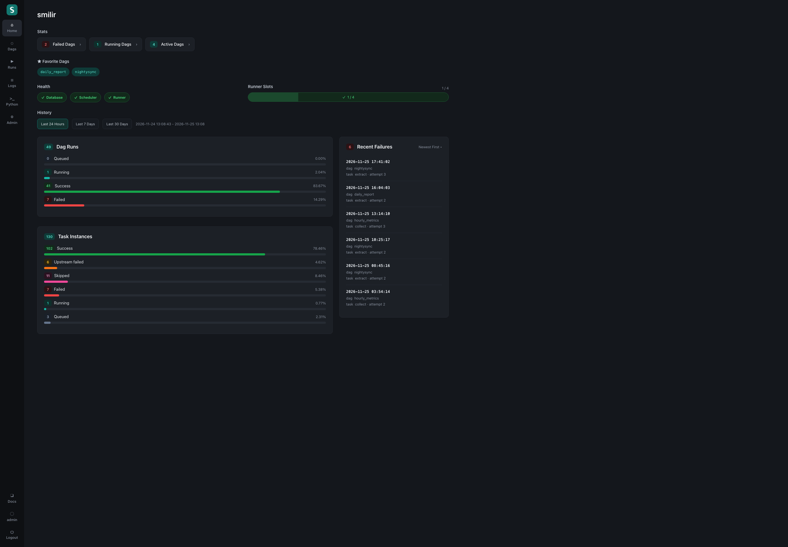
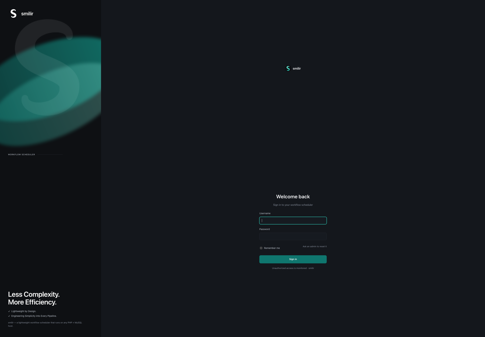

<p align="center">
  <picture>
    <source media="(prefers-color-scheme: dark)" srcset="docs/logo-white.png">
    
  </picture>
</p>

<h1 align="center">smilir</h1>

<p align="center">
  <em>Less Complexity. More Efficiency.</em><br>
  A lightweight, <strong>Python-first</strong> workflow scheduler built for cheap cPanel hosting.
</p>

<p align="center">
  
  
  
  
  
  
  
</p>

<p align="center">
  
</p>

---

## Table of Contents

- [Why smilir?](#why-smilir)
- [Architecture Overview](#architecture-overview)
- [Quick Start](#quick-start)
- [Run with Docker](#run-with-docker)
- [Deploy to cPanel](#deploy-to-cpanel)
- [DAG Format](#dag-format)
- [Web Console](#web-console)
- [CLI Reference](#cli-reference)
- [Updating](#updating)
- [Testing](#testing)
- [Repository Layout](#repository-layout)
- [Security](#security)
- [License](#license)

---

## Why smilir?

Most schedulers assume a dedicated server. **smilir assumes a $5 shared hosting plan**: PHP, MySQL, and one cron line. It keeps the useful 20% of Airflow — DAGs, dependencies, retries, timeouts, run history, logs — and drops the rest.

| Feature | Description |
|---------|-------------|
| 🐍 **Python-first DAGs** | `dags/foo.py` exposes a `DAG` dict; tasks are `func`s or shell commands |
| 📦 **Managed venvs** | Every environment has its own interpreter and package set; no dependency conflicts between pipelines |
| ⚡ **Zero-install runner** | `lib/dag_loader.py` and `lib/runner.py` are stdlib-only and injected via `PYTHONPATH`. Nothing to `pip install` |
| 💰 **Cheap to run** | A 60-second cron tick is the whole "scheduler daemon"; no workers, no Redis, no broker |
| 🛠 **Operator friendly** | Retries with backoff, `upstream_failed` cascade, per-attempt logs, email alerts, `ops.php` CLI, and a dark web console |

---

## Architecture Overview

```
cron (every minute)
  └─ app/scheduler.php ── tick ────────────────┬─ schedule due DAGs (cron / interval)
       │                                       ├─ cascade outcomes (upstream_failed / skipped)
       │                                       ├─ dispatch ready tasks (max_concurrency)
       │                                       └─ retries, timeouts, close runs
       ├─ app/src/DagLoader.php ──► <venv>/bin/python lib/dag_loader.py dags/*.py  (sha256 cache)
       └─ app/runner.php (detached) ─► <venv>/bin/python lib/runner.py --func jobs.mod.fn
                                          or /bin/sh -c "<command with {ds}>"
```

**State** lives in MySQL (`pn_dag`, `pn_task`, `pn_dag_run`, `pn_task_run`, `pn_venv`, `pn_venv_package`, `pn_user`); **logs** are plain files under `logs/runs/`.

---

## Quick Start

```bash
# 1. Configure
cp app/config.example.php app/config.php          # DB credentials + python_bin

# 2. Install schema + create admin + default venv
php app/install.php --admin=admin:secret \
    --venv=reporting:/home/USER/venvs/reporting

# 3. Validate a DAG
php app/dagcheck.php --file=dags/daily_report.py

# 4. Run one manual tick
php app/scheduler.php
```

**Cron** (one line, every minute):

```bash
* * * * * /usr/local/bin/php /home/USER/pipnix/app/scheduler.php >> /home/USER/pipnix/logs/cron.log 2>&1
```

**Requirements:** PHP 8.1+ CLI (`proc_open` allowed), MySQL 5.7+/MariaDB 10.3+, Python 3.8+ with a venv (cPanel → *Setup Python App*).

📖 **Complete installation-to-update manual:** [docs/GUIDE.md](docs/GUIDE.md), also available in the console at **Docs → Getting started** (`/docs`).

---

## Run with Docker

One container carries the web console, the PHP CLI, Python 3, and the one-minute scheduler (supercronic); compose adds MySQL:

```bash
cp .env.example .env            # database + admin secrets, host port
docker compose up -d --build
# → http://localhost:8080
```

Your pipelines live in `./dags` and `./jobs` (bind-mounted); the database, logs, storage, and Python venvs live in named volumes and survive rebuilds. The first boot creates `admin:admin` — the console forces a new password before anything else. Set `PIPNIX_ADMIN_PASS` to start with a different temporary password.

```bash
make docker-up        # docker compose up -d --build
make docker-logs      # follow Apache + scheduler output
make docker-down      # stop, keep data
```

📖 **Full guide: [docs/DOCKER.md](docs/DOCKER.md)** — upgrades, backups, Python packages, reverse proxy/TLS, alerts and troubleshooting.

---

## Deploy to cPanel

smilir ships as one release zip and runs on plain shared hosting — no root, no workers, no Node build:

```bash
make dist                                        # deployment: dist/pipnix-v1.0.0.zip
make dist PREFIX=smilir                          # clean install: dist/smilir-v1.0.0.zip
```

Then in cPanel:

1. **Upload & extract** the zip to `/home/USER/` (File Manager)
2. Copy the contents of `pipnix/public/` into `public_html/pipnix/` — everything else stays in `~/pipnix/`, outside the web root. The front controller auto-detects `~/pipnix/app`; override with the `PIPNIX_APP` env var if needed.
3. **MultiPHP Manager** → PHP 8.1+ for the domain
4. **MySQL® Databases** → create DB + user (ALL PRIVILEGES)
5. Copy `app/config.example.php` → `app/config.php`, fill in the DB credentials, then run once in Terminal:
   `php app/install.php --admin=you:strong-password`
6. **Setup Python App** → create a venv, register it in the console (**Python → Register environment**, tick *make default*)
7. **Cron Jobs** → every minute:
   ```bash
   * * * * * /usr/local/bin/php /home/USER/pipnix/app/scheduler.php >> /home/USER/pipnix/logs/cron.log 2>&1
   ```
8. Log in at `https://yourdomain.com/pipnix/`, import a DAG, **Trigger**, done.

📖 **Full walkthrough (with troubleshooting table, retention cron, and security checklist):** [docs/DEPLOY.md](docs/DEPLOY.md).

> `app/config.php`, `dags/`, `jobs/` and `logs/` never leave `~/pipnix/` — the web root only ever exposes the contents of `public/`.

<table>
<tr>
<td></td>
<td></td>
</tr>
</table>

Everything is operational end to end: the DAG editor (writes + re-validates `dags/<name>.py`), `.py` import with a parsed preview, trigger / pause / clear / mark-success actions, venv + pip management with a live log, user management and an audit trail.

---

## DAG Format

```python
# dags/daily_report.py
DAG = {
    "name": "daily_report",
    "schedule": "0 3 * * *",                 # or "interval:60"
    "venv": "reporting",
    "max_concurrency": 1,
    "tasks": [
        {"name": "extract",   "func": "jobs.reporting.extract", "retries": 2, "timeout": 300},
        {"name": "transform", "func": "jobs.reporting.transform", "depends_on": ["extract"]},
        {"name": "load",      "func": "jobs.reporting.load",      "depends_on": ["transform"]},
        {"name": "publish",   "command": "python -m jobs.reporting publish --date {ds}",
         "depends_on": ["load"]},
    ],
}
```

| Task key | Meaning |
| --- | --- |
| `func` | Dotted `module.function`, called with the context kwargs it declares (`ds`, `run_id`, `attempt`, `params`, `task`, `dag`); JSON return value is stored in `result_json` |
| `command` | Shell string executed with the venv first on `PATH`; `{ds}` = logical date |
| `depends_on` | Task names; failures cascade as `upstream_failed` |
| `retries` / `retry_delay` | Extra attempts with linear backoff |
| `timeout` | Seconds; enforced by both the runner and the tick |

Malformed DAGs are rejected with a precise message (`dagcheck` prints the normalized JSON). Files are only re-executed when their sha256 changes.

📖 **Full authoring guide: [docs/DAGS.md](docs/DAGS.md)** — every key, the `func`/`command` contracts, schedule semantics, validation rules and patterns. Runnable examples: [`dags/examples/`](dags/examples/) (copy to `dags/` to activate).

---

## Web Console

Server-rendered PHP console — no build step, no JS framework:

```bash
php -S 127.0.0.1:8099 -t public public/index.php
# → http://127.0.0.1:8099  (sign in with the admin created by install.php)
```

**Pages:**
- **Home** — stats, health, runner slots, favorites, 24h/7d/30d breakdowns, recent failures
- **Dags** — searchable list with star/pin, detail with **Grid · Graph · Gantt · Code** tabs and a run grid
- **Runs** — filterable list, run detail and task-instance drill-down
- **Logs** — per-attempt viewer with filter/highlight/download
- **Python** — create/register venvs, install, upgrade all, requirements.txt, delete guard, package inventory
- **Admin** — users + roles, scheduler/task-default/alerting/retention settings with purge, audit log

---

## CLI Reference

```bash
php app/ops.php dags                        # schedule, active, last state
php app/ops.php runs --dag=daily_report     # recent runs
php app/ops.php tasks --run=12              # task rows of one run
php app/ops.php trigger --dag=daily_report  # manual run
php app/ops.php pause|resume --dag=...      # scheduling toggle
php app/ops.php clear --run=34              # requeue task + downstream
php app/ops.php logs --run=34 --tail=100    # tail an attempt
php app/ops.php venv:check|list|install ...  # interpreter + pip management
php app/ops.php prune --days=30             # drop old finished runs + logs
php app/dagcheck.php --file=dags/x.py       # validate a DAG file
```

---

## Updating

**Admin → Updates** compares this installation with GitHub (a release tag or the newest commit of a branch) and applies a backup-first update: `app/`, `public/` and the rest of the code are replaced, while `app/config.php`, `.env`, `dags/`, `jobs/`, `logs/` and `storage/` are never touched; migrations run afterwards, and the previous files can be rolled back. Hosts without outbound access can upload a release zip instead.

```bash
php app/ops.php update:check
php app/ops.php update:apply
php app/ops.php update:rollback
```

📖 **Guide: [docs/UPDATE.md](docs/UPDATE.md)** — channels, tokens for private forks, permissions, Docker behaviour and troubleshooting.

> **cPanel note:** The standard deployment copies `public/` into `public_html/pipnix/`. The built-in updater does not yet synchronize that separate webroot; follow the manual copy step in [docs/UPDATE.md](docs/UPDATE.md) after updating, or point the document root directly at `pipnix/public/`.

---

## Testing

```bash
make check                    # PHP lint + cron/logger unit tests (no DB)
PN_MYSQL_PORT=3307 make e2e   # full integration test against a dev MySQL
PN_MYSQL_PORT=3307 make ui    # web console smoke test (auth + every page)
PN_MYSQL_PORT=3307 make ui-actions  # write-action tests (editor, import, trigger, venv, users)
PN_MYSQL_PORT=3307 make pass-change   # weak install password → forced change flow
make docker-smoke                    # Docker stack: boot, login, run a DAG (needs Docker)
```

The e2e suite provisions a real venv and database, then verifies: schema install, pip inventory, DAG loading with hash cache, trigger → dispatch → success, `result_json`, per-attempt logs, failure cascade, clear/rerun, pause/resume. The web suites cover login/roles, every read-only page, the DAG editor and import flow, trigger/pause/clear/mark actions, favorites and the Grid/Graph/Gantt/Code tabs, the task-instance and log pages, settings (defaults, retention, purge), venv create/delete/requirements with the delete guard, user roles and the audit log.

---

## Repository Layout

```
app/                  scheduler.php · runner.php · ops.php · dagcheck.php · install.php
app/src/              Env, Db, Lock, Cron, DagLoader, Scheduler, Runner, Logger, Alerter
lib/                  dag_loader.py + runner.py (stdlib only)
public/               web console (index.php + views/ + assets/)
dags/ · jobs/         DAG definitions and task code
tests/                unit tests (php/) + e2e harness
docs/                 GUIDE.md, DEPLOY.md, DAGS.md, DOCKER.md, UPDATE.md
docs/BRAND.md         rename policy + staged repo/path/Docker runbook
docs/brand/           brand SVGs + palette (source of truth for the mark)
dags/examples/        copy-paste DAG patterns (not auto-loaded)
docker/ · docker-compose.yml   single-container + MySQL deployment
schema.sql · Makefile · README.md
```

---

## Security

- Private code, DAGs, jobs and logs live **outside** the web root; entry points refuse non-CLI SAPI
- All SQL uses prepared statements; commands are escaped with `escapeshellarg`
- DAG files are **code** and execute at load time (same trust model as Airflow): loading is admin-only in the UI, runs in a subprocess with a 10s timeout, and files must live in `dags/`
- Tasks may only use interpreters registered in `pn_venv`
- Sessions are `HttpOnly` + `SameSite=Lax`; every POST is CSRF-checked; login throttled per session

---

## License

[MIT](LICENSE) — free to use, modify and self-host.